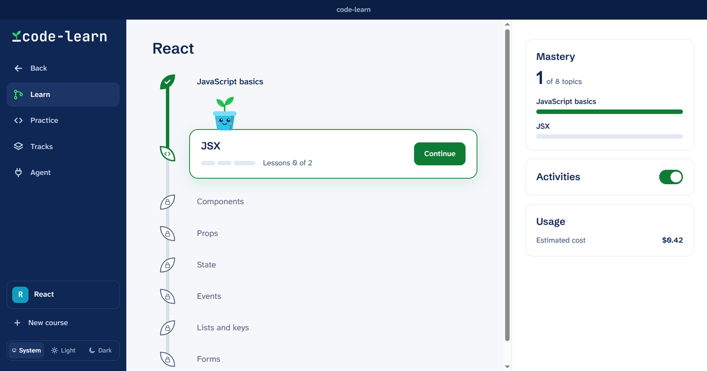
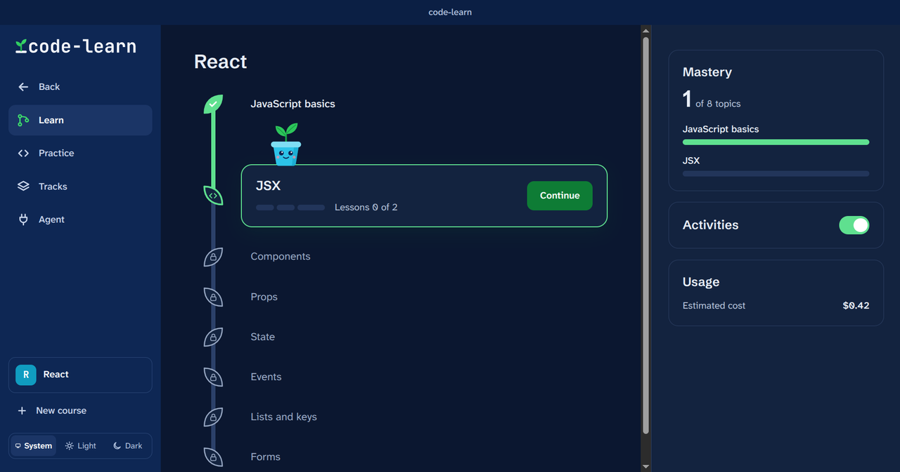
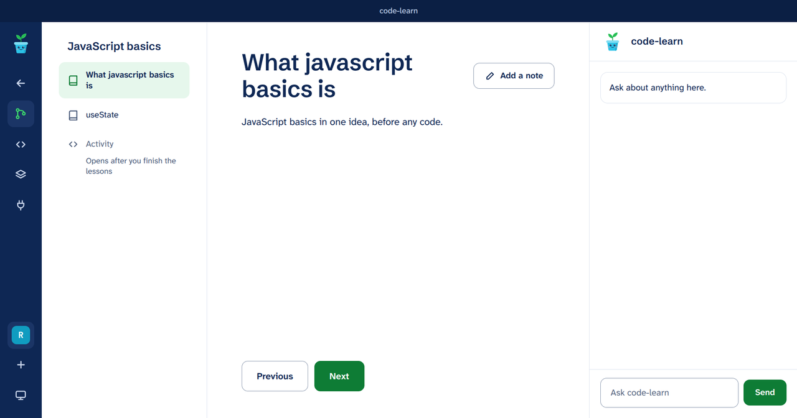
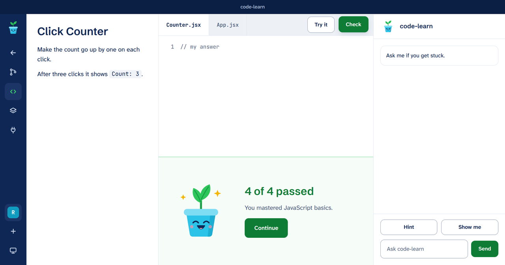
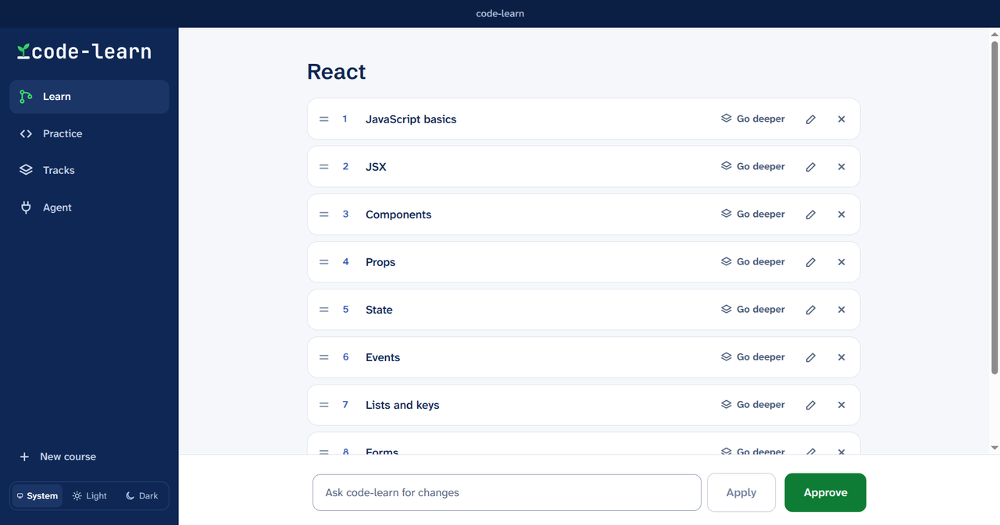
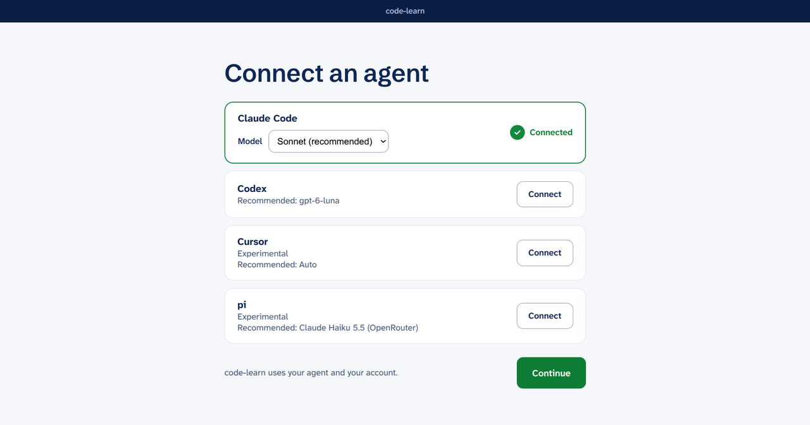

<p align="center">
  <picture>
    <source media="(prefers-color-scheme: dark)" srcset="docs/brand/code-learn-logo-dark.svg">
    
  </picture>
</p>

<p align="center"></p>

# code-learn

code-learn is a Linux app for learning to code by practice: your own coding agent writes the lessons and graded exercises, and code-learn checks, grades and tracks your progress.

> [!NOTE]
> code-learn is a fork of [Codemm](https://github.com/iignaite/Codemm) (MIT), forked from its version 1.0.0-beta.10. Codemm runs every exercise in Docker and ships for macOS and Windows. code-learn is Linux only and has no Docker: each language is installed on your computer into its own removable folder, and every check runs in a [bubblewrap](https://github.com/containers/bubblewrap) sandbox. The rest of the design (agents writing tracks, roadmaps and exercises; code-learn verifying and grading them) is Codemm's.

## Overview

Your agent (Claude Code, Codex, Cursor or [pi](https://pi.dev), signed in with your own account) writes everything a course needs: a roadmap of topics, a lesson per topic, and exercises with hidden tests. code-learn launches the agent with only code-learn's tools, checks each exercise before you see it, runs your code in a sandbox and keeps a per-topic mastery score. code-learn never calls a model API, and it never reads, stores or asks for credentials.

code-learn ships no languages. The first time a course needs a language or framework, your agent writes a *track*: a list of [conda-forge](https://conda-forge.org) packages (for example `python=3.13` and `pytest`), an optional setup command, and two small probe programs. code-learn installs the packages with [micromamba](https://mamba.readthedocs.io) into `~/.code-learn/envs/<track>@<version>/`, then installs the track only if a correct probe passes and a wrong probe fails, with the network off.

## Screenshots

| | |
|---|---|
|  |  |
| The course path, with Sprig on the topic to do now | The dark theme follows the desktop, or set it in the sidebar |
|  |  |
| A lesson, with the topic's outline and the tutor | An exercise, checked in the sandbox |
|  |  |
| The roadmap your agent proposes, editable before you approve it | Connect the agent you already use |

## How it works

1. **Connect your agent.** code-learn checks this computer: bubblewrap and a systemd user session are present, and a self-test inside the sandbox confirms there is no network, no home folder and no writable system folder.
2. **Say what you want to learn.** Your agent writes a roadmap of topics. You can approve it, ask for changes, or rename, reorder, add and remove topics yourself.
3. **Agree to setup once.** Your agent proposes a track. code-learn shows you its files and installs exactly those, only after you agree. Installing downloads the packages and runs the setup command with network access, inside a sandbox that can write only the track's own folder.
4. **Read the lesson** for each topic, and keep notes beside it.
5. **Do the activity.** Your agent writes an exercise: a statement, starter code, a reference solution, 2 to 4 deliberately broken variants, and visible and hidden tests. code-learn accepts it only if the reference passes, the starter fails, and the tests catch every broken variant. You edit the code, use **Try it** for the visible tests, then **Check**.
6. **Ask code-learn** when you're stuck. It explains and hints; it doesn't edit your code.

Try it is never recorded. Check records an attempt, except for a check of the unedited starter or one that failed for a reason outside your code, such as a sandbox problem. Mastery moves only on an exercise's first check, or when you beat your best score on it.

## Requirements

- Linux on x86_64, logged in to a desktop session with systemd (most distributions).
- bubblewrap 0.9 or later. Install it with your package manager, for example `sudo pacman -S bubblewrap` (Arch, CachyOS), `sudo apt install bubblewrap` (Debian, Ubuntu), `sudo dnf install bubblewrap` (Fedora) or `sudo zypper install bubblewrap` (openSUSE).
- Claude Code or Codex, installed and signed in. Cursor and pi are experimental; for pi, code-learn suggests Claude Haiku 5.5 through OpenRouter (`openrouter/anthropic/claude-haiku-5.5`).
- About 5 GB of free disk space for each track you install. A Python track with pytest takes about 450 MB.

The desktop app bundles micromamba. From a terminal you also need Node.js 22 or later and micromamba 2 on your `PATH` (or `CODE_LEARN_MICROMAMBA` set to its path).

## Install

Download the AppImage from the [latest release](https://github.com/shourovrm/code-learn/releases) (a pre-release for now), make it executable and run it:

```bash
chmod +x code-learn-*.AppImage
./code-learn-*.AppImage
```

Running an AppImage needs FUSE 2 (`fuse2` on Arch).

### From source

The command-line core:

```bash
git clone https://github.com/shourovrm/code-learn.git
cd code-learn
npm ci
npm run build
```

### Desktop app

```bash
cd desktop
npm ci
npm run dist
```

`npm run dist` downloads micromamba 2.10.0 (checked against its pinned SHA-256) and writes an AppImage and a pacman package to `desktop/release/`. Run the AppImage directly, or install the package with `sudo pacman -U desktop/release/code-learn-*.pacman`. Running an AppImage needs FUSE 2 (`fuse2` on Arch).

### Terminal

```bash
npm link
code-learn doctor
```

`code-learn doctor` checks bubblewrap, the systemd user session, micromamba and your data folder, then runs the isolation self-test. In an empty project folder, run:

```bash
code-learn init
```

This sets up Claude Code, Codex, Cursor and pi; use `--host claude` (repeatable) to pick specific ones. pi loads the project's `.pi/mcp.json` once you trust the folder the first time you start pi in it. It adds an MCP server entry for each agent, a code-learn section in `AGENTS.md`, an author subagent and the Claude Code practice hook. Existing config is merged, never replaced. Open the folder in your agent and say what you want to learn.

| Command | What it does |
|---|---|
| `code-learn init [--host claude\|codex\|cursor\|pi]` | Set up this project for your agent(s) |
| `code-learn doctor [--fix]` | Check the sandbox, micromamba and isolation; `--fix` stops sandboxes a crashed run left |
| `code-learn status` | Your progress and the next step |
| `code-learn test [exercise]` | Run the visible tests (not recorded) |
| `code-learn check [exercise]` | Run every test and record the attempt |
| `code-learn skip <concept>` | Come back to a concept later |
| `code-learn assist on\|off` | Let your agent edit exercise files (counts for less) |
| `code-learn tracks` | List installed tracks |
| `code-learn track add <folder>` | Install a track from a folder |
| `code-learn track rebuild <id@version>` | Reinstall a track's toolchain and re-verify its exercises |
| `code-learn track remove <id@version>` | Delete a track and its toolchain folder |

The practice hook works in Claude Code only. It blocks the `Edit`, `Write`, `MultiEdit` and `NotebookEdit` tools on files under `exercises/` unless you run `code-learn assist on`. Writes through the shell aren't blocked, and in Codex, Cursor and pi only the instructions in `AGENTS.md` ask the agent not to edit your files.

## Removing what code-learn installed

`code-learn track remove python@1` (or **Remove** under Tracks in the app) deletes that track's folder in `~/.code-learn/envs/`. It is refused while a course uses the track. `~/.code-learn/pkgs/` holds micromamba's download cache, which you can delete at any time. Deleting `~/.code-learn` removes everything code-learn installed; nothing else on your computer changes.

## Sandbox

Every check, Run and install step runs in bubblewrap inside its own systemd user scope:

- **Checks and Run** see your system's `/usr` read-only, the track's packages at `/opt/env` and its files at `/opt/track` read-only, your exercise files at `/work/src` read-only, the tests at `/work/tests`, and a 256 MB `/tmp`. They have no network, can't see your home folder or `~/.code-learn`, and are limited in memory, processes (256) and CPU (2 cores).
- **Install steps** have network access and can write only the track's staging folder and micromamba's cache.
- **Grading is on the honor system.** Code in the sandbox could fake its own result, as in Codemm. code-learn is built for self-learners, not graded classwork.

The full specification is in [docs/DESIGN.md §4.6](docs/DESIGN.md).

## Tests

```bash
npm run typecheck
npm test                  # core: unit tests and the sandbox integration suite
cd desktop && npm test    # desktop app
```

The sandbox tests run when bubblewrap and a systemd user session are present; set `CODE_LEARN_REQUIRE_SANDBOX=1` to make a missing sandbox fail instead of skip. `CODE_LEARN_REAL_MICROMAMBA=1` also runs the tests that install real conda-forge packages (a JDK and Maven; several minutes and network).

## Documentation

- [Design](docs/DESIGN.md): the core spec, formats and gates; §4.6 is code-learn's native engine
- [Desktop design](docs/desktop/DESIGN.md): the app, the agent bridge and the acceptance criteria (still describes Codemm's Docker screens in places)
- [Architecture](docs/architecture.md) and [Security](docs/SECURITY.md), from Codemm

## License

[MIT](LICENSE). code-learn keeps Codemm's copyright notice alongside its own.
