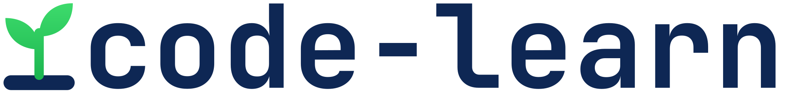

<p align="center">
  <picture>
    <source media="(prefers-color-scheme: dark)" srcset="docs/brand/code-learn-logo-dark.svg">
    
  </picture>
</p>

<p align="center">
  <picture>
    <source media="(prefers-color-scheme: dark)" srcset="docs/brand/emm-dark.svg">
    
  </picture>
</p>

<p align="center"><strong>Supercharge your coding journey with your own coding agent.</strong></p>

<p align="center">
  <a href="https://github.com/iignaite/Codemm/actions/workflows/ci.yml"></a>
  <a href="LICENSE"></a>
  
</p>

<p align="center">
  <a href="https://codemm.vercel.app/#watch"></a>
  <br>
  <a href="https://codemm.vercel.app/#watch"><strong>▶ Watch the one-minute video</strong></a>
</p>

## What is code-learn

code-learn is an open-source app for learning to code by practice. Your own coding agent (Claude Code or Codex, with your own account) writes the lessons and exercises. code-learn checks each exercise against its tests, grades your code in a sandbox, and tracks what you've mastered.

code-learn launches your agent; it never calls a model API, and it never reads, stores or asks for credentials. It ships no languages: your agent sets up each language or framework the first time you need it, and code-learn checks that it works.

## How it works

1. **Connect your agent** and let code-learn check this computer (Docker installed, running, and the sandbox working).
2. **Say what you want to learn.** Your agent writes a roadmap of topics. You can approve it, ask for changes, or rename, reorder, add and remove topics yourself.
3. **Agree to setup once.** Your agent proposes an environment for the language (a Dockerfile, a `track.yaml` and small probe programs). code-learn shows you the files and builds exactly those, only after you agree, and installs the track only if its probes pass with the network off.
4. **Read the lesson** for each topic, and keep notes beside it.
5. **Do the activity.** Your agent writes an exercise: a statement, starter code, a reference solution, 2–4 deliberately broken variants, and visible and hidden tests. code-learn accepts it only if the reference passes, the starter fails, and the tests catch every broken variant. You edit the code, use **Try it** for the visible tests, then **Check**.
6. **Ask code-learn** when you're stuck. It explains and hints; it doesn't edit your code. Skip means "come back later", never "mastered".

**What counts.** Try it is never recorded. Check records an attempt, except for a check of the unedited starter or one that failed for a reason outside your code (Docker stopped, for example). Mastery moves only on an exercise's first check, or when you beat your best score on it; re-checking a solved exercise adds nothing. Difficulty goes up (to at most 3) after a first-try pass without assistance, and down (to 1) after repeated failures.

## Install (beta)

A private beta is planned once the packaged app passes its macOS and Windows journeys. When a beta build is published on the [Releases page](https://github.com/iignaite/Codemm/releases), download the installer for your computer:

- **macOS** (Apple Silicon or Intel): the `.dmg`. Beta builds are unsigned: open the app once, then choose System Settings, Privacy & Security, Open Anyway.
- **Windows** (x64): the installer. Beta builds are unsigned: in the SmartScreen prompt, choose More info, then Run anyway.

You also need:

- **Docker Desktop**, running. On Windows, use the WSL 2 backend with Linux containers. No Docker? See below.
- **Claude Code or Codex**, installed and signed in. Cursor is experimental.

The app bundles code-learn, so you don't need Node.js, npm or a terminal. The public 1.0 will be signed.

### No Docker? (school or work computers)

Installing Docker Desktop needs admin rights, which school and work computers often don't give. Without Docker, the desktop app can still run io practice (programs that read input and print output) in interpreted languages that have a WebAssembly (WASI) build, such as Python. It bundles [wasmtime](https://wasmtime.dev), a sandbox that runs as your own user, with no admin rights. In Check this computer, choose **Continue without Docker**.

For everything else, such as unit tests, frameworks and compiled languages, ask whoever manages the computer to install Docker Desktop once ([Docker's terms](https://docs.docker.com/subscription/desktop-license/) list education among free uses), or use a computer that has Docker.

## Use from a terminal

code-learn also works directly from your agent in a terminal. This needs Node.js 22 or newer and Docker (or [wasmtime](https://wasmtime.dev) 50 on `PATH`, for the practice above), and installs from source (code-learn isn't on npm):

```bash
git clone https://github.com/iignaite/Codemm.git
```

```bash
cd code-learn && npm ci && npm run build && npm link
```

Check that Docker and the sandbox work:

```bash
code-learn doctor
```

Then, in an empty project folder:

```bash
code-learn init
```

This sets up Claude Code, Codex and Cursor; use `--host claude` (repeatable) to pick specific ones. It adds an MCP server entry for each agent, a code-learn section in `AGENTS.md`, an author subagent and the Claude Code practice hook. Existing config is merged, never replaced. Open the folder in your agent and say what you want to learn.

**The practice hook is Claude Code-only, and a practice aid rather than a lock.** In Claude Code it blocks the `Edit`, `Write`, `MultiEdit` and `NotebookEdit` tools on files under `exercises/` unless you run `code-learn assist on` (assisted attempts count for less). Writes through the shell aren't blocked. In Codex and Cursor, the instructions in `AGENTS.md` ask the agent not to edit your files, but nothing enforces it.

> [!NOTE]
> Codex loads `.codex/config.toml` only for projects you've marked as trusted, and asks before each code-learn tool call. To skip those prompts, add `default_tools_approval_mode = "approve"` under `[mcp_servers.code-learn]`; that also skips your approval for `save_track`, which runs a network build.

| Command | What it does |
|---|---|
| `code-learn init [--host claude\|codex\|cursor]` | Set up this project for your agent(s) |
| `code-learn doctor [--fix]` | Check Docker and prove the sandbox has no network |
| `code-learn status` | Your progress and the next step |
| `code-learn test [exercise]` | Run the visible tests (not recorded) |
| `code-learn check [exercise]` | Run every test and record the attempt |
| `code-learn skip <concept>` | Come back to a concept later |
| `code-learn assist on\|off` | Let your agent edit exercise files (counts for less) |
| `code-learn tracks` | List installed tracks |
| `code-learn track add <folder>` | Install a track from a folder |
| `code-learn track rebuild <id@version>` | Rebuild a track image and re-verify its exercises |

Your agent uses the MCP tools `list_tracks`, `save_track`, `save_roadmap`, `get_roadmap`, `next_step`, `save_exercise`, `get_exercise`, `check`, `progress`, `save_lesson`, `get_lesson` and `mark_lesson_read`.

## What's verified

| | Verified | Not yet |
|---|---|---|
| **Desktop app** | Unit and packaged smoke tests in CI on macOS and Windows | The full journeys with real agents on a packaged build: macOS (D17) and a whole course on Windows (D18) |
| **Terminal** | Claude Code and Codex end to end on macOS with Docker Desktop ([1.0 release evidence](docs/release-evidence-1.0.md)); core unit tests on macOS, Linux and Windows, and Docker tests on Linux, in CI | Windows with a real agent; Podman; Cursor |
| **Models** | The [cross-model bench](docs/bench/results.md) recommends a minimum model per agent | The bench measured the terminal flow (tutor plus author subagent). The desktop app runs each job separately, with fewer tools, and isn't benchmarked yet. |

## Good to know

- **Setup runs code your agent wrote, with network access**, like `npm install` in someone else's project. Agree only to setups you'd run yourself. Checks always run with the network off and with memory, CPU, process and time limits.
- **Grading is on the honor system.** Hidden tests are hidden from your agent's tools, not from your computer, and code in the sandbox could fake its own result. code-learn is built for self-learners, not graded classwork.
- **code-learn proves an exercise is consistent, not that its statement is right.** If something reads wrong, tell code-learn.
- **Docker Desktop can use a lot of memory**, up to half of your computer's by default. On a Mac, you can lower it in Docker Desktop under Settings, Resources, Advanced, Memory limit. On Windows with WSL 2, WSL sets this limit instead, also half by default; [Docker's settings page](https://docs.docker.com/desktop/settings-and-maintenance/settings/) points to where to change it. Too low a limit can make setups and checks fail, even for correct code; raise it again if they do.
- **Your data** (tracks, courses and attempt history) lives in `~/.code-learn`; set `CODE_LEARN_HOME` to move it. The app keeps your exercise files in `~/code-learn`; from a terminal, your project folder holds `code-learn.json` and `exercises/`.

## Documentation

- [Docs index](docs/README.md)
- [Architecture](docs/architecture.md): how the parts connect and how the data is stored, with diagrams
- [Design](docs/DESIGN.md): the core spec, formats and gates
- [Desktop design](docs/desktop/DESIGN.md): the app, the agent bridge and the acceptance criteria
- [Security](docs/SECURITY.md): the sandbox, trust boundaries and known limits
- [Bench results](docs/bench/results.md): how models from weak to strong do with code-learn
- [Changelog](CHANGELOG.md)

## Contributing

Contributions are welcome. Read [CONTRIBUTING.md](CONTRIBUTING.md) and [AGENTS.md](AGENTS.md) first; code-learn stays small on purpose.

## License

[MIT](LICENSE)
